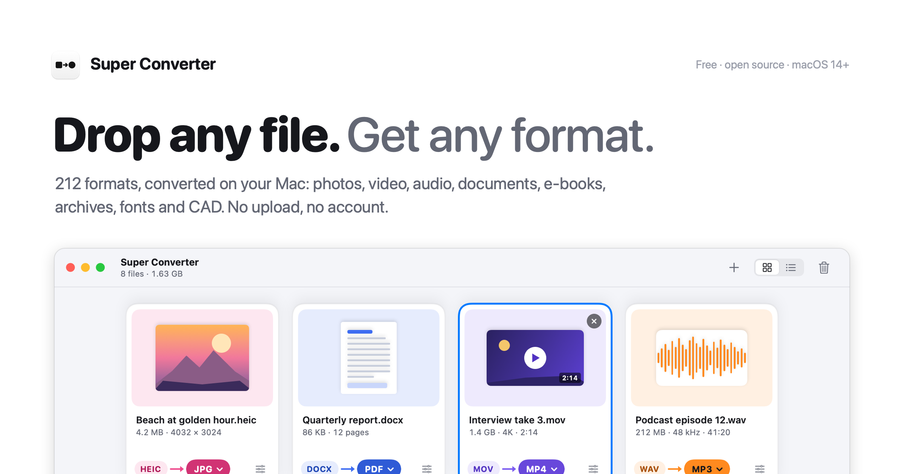
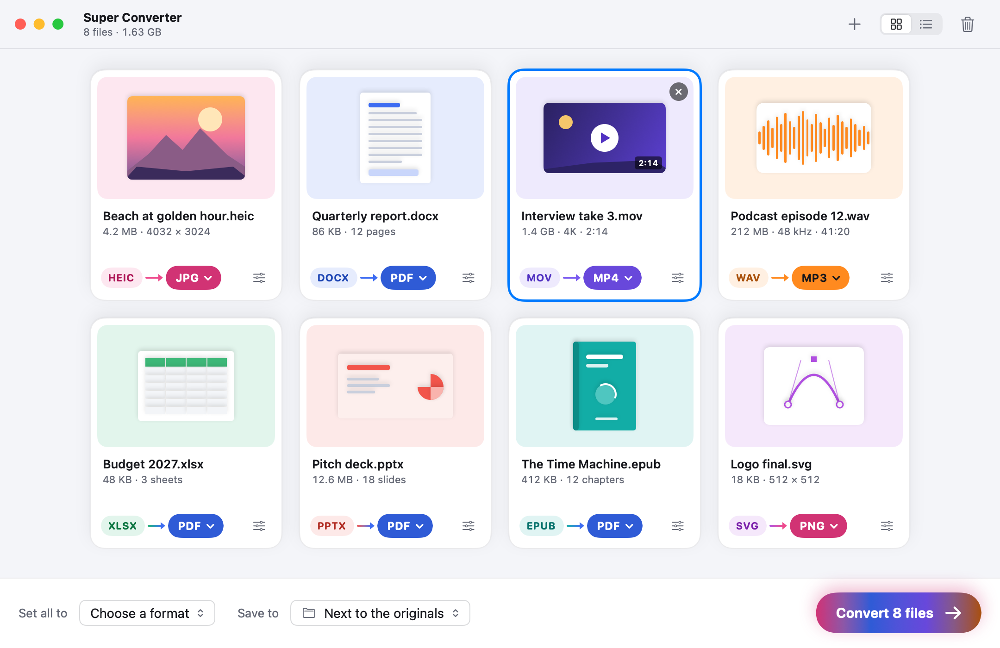
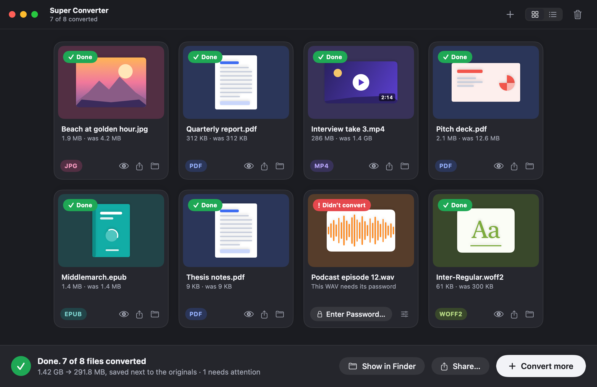

<p align="center">
  <a href="https://udsy19.github.io/super-converter/"></a>
</p>

<h1 align="center">Super Converter</h1>

<p align="center">
  <b>A free, open-source file converter for macOS.</b><br>
  Drop any file. Get any format. Everything happens on your Mac.
</p>

<p align="center">
  <a href="https://github.com/udsy19/super-converter/releases/latest"></a>
  <a href="https://github.com/udsy19/super-converter/actions/workflows/ci.yml"></a>
  <a href="LICENSE"></a>
  
  
  
</p>

<p align="center">
  <a href="https://udsy19.github.io/super-converter/"><b>Website</b></a> ·
  <a href="https://github.com/udsy19/super-converter/releases/latest/download/SuperConverter.dmg"><b>Download DMG</b></a> ·
  <a href="docs/USAGE.md">User guide</a> ·
  <a href="docs/specs/formats.md">Formats</a> ·
  <a href="docs/ARCHITECTURE.md">Architecture</a> ·
  <a href="CHANGELOG.md">Changelog</a>
</p>

---

Super Converter does what CloudConvert does, on your own Mac. Drop files on the window, the Dock icon or the menu-bar
icon, or right-click them in Finder, and each becomes a colourful card that already knows what it will most likely
become (HEIC → JPG, MOV → MP4, DOCX → PDF, PDF → Word). Pick another format from a short, searchable list if you like,
press **Convert**, and the new files appear next to the originals. 212 formats in 11 kinds: photos and camera RAW,
video, audio, documents, spreadsheets, slides, e-books, archives, vector art, CAD drawings and fonts. No account, no
upload, no analytics; the originals are never touched.

```bash
curl -fsSL https://udsy19.github.io/super-converter/install.sh | bash
```

## Contents

- [Screenshots](#screenshots)
- [Features](#features)
- [Install](#install)
- [Usage](#usage)
- [Privacy and security](#privacy-and-security)
- [Helpers](#helpers)
- [Command line](#command-line)
- [URL scheme](#url-scheme)
- [Architecture](#architecture)
- [Building from source](#building-from-source)
- [Contributing](#contributing)
- [FAQ](#faq)
- [Roadmap](#roadmap)
- [Credits](#credits)
- [Licence](#licence)

## Screenshots

These are rendered from the app's own UI by the self-tests (`SUPERCONVERTER_RENDER_DIR`), so they're exact.

<p align="center">
  
  <br><sub>Eight files, eight kinds. Each card shows the file, the one or two facts that matter (pixel size, pages, duration) and what it will become; the arrow runs from the source's colour to the target's.</sub>
</p>

<p align="center">
  
  <br><sub>Done, in dark mode. Each card turns to its new format's colour and shows the new size; the one that couldn't convert says why and offers the fix.</sub>
</p>

<table>
  <tr>
    <td width="50%"><br><sub>The format picker: search by extension, name or plain words ("word", "kindle", "transparent"), or take one of the best picks.</sub></td>
    <td width="50%"><br><sub>Options in plain words, with a live size estimate; the technical ones wait under More options.</sub></td>
  </tr>
  <tr>
    <td><br><sub>Converting: progress in the colours of the conversion. A file that needs a free helper says so on its card, with Install.</sub></td>
    <td><br><sub>The empty window is one big drop zone, with the popular pairs one click away.</sub></td>
  </tr>
  <tr>
    <td><br><sub>The menu-bar panel: drop files on the icon and convert without opening the window.</sub></td>
    <td><br><sub>Settings › Helpers: the free tools that unlock the rest, each with what it adds and one-click Install where upstream allows.</sub></td>
  </tr>
</table>

## Features

**Converting**

- 212 formats in 11 kinds and 2,252 conversions between them: 2,140 of the 2,156 pairs in CloudConvert's public
  format list, plus 112 more. (Of the other 16, GIF and WebP → audio can't produce anything real, DSS → DSS has no
  encoder outside Olympus' software, and AMR encoding is held back over patents.) Every pair and the engine that
  does it is listed in [formats.md](docs/specs/formats.md).
- A sensible default for every source (HEIC → JPG, MOV → MP4, PDF → Word, EPUB → PDF, TTF → WOFF2…); your last
  choice for a kind of file wins from then on.
- Files are recognised by their content, not their name: a `.jpg` that is really a PNG is treated as a PNG and the
  card says so.
- Several files convert at once, a long video alongside small images; the Mac doesn't sleep while it works and the
  window can close while conversions continue.

**Results that are right**

- Colour profiles kept or converted exactly, gamma-correct Lanczos resizing, photo details kept (or everything but the
  location, or nothing).
- Audio and video defaults that look and sound like the original, with hardware encoding through VideoToolbox.
- Documents typeset like LaTeX: Latin Modern, Knuth–Plass line breaking, TeX math, booktabs tables, tagged PDF and
  bookmarks. Or "As written", or the original layout through LibreOffice.
- What a conversion can't carry over (layers, animation, comments) is said on the card. Every promise is measured
  by an automated quality bench ([quality.md](docs/specs/quality.md)).

**Nothing is lost**

- New files go next to the originals with the same name and the new extension; collisions get " 2". Originals are
  never moved, renamed or deleted, and a half-written file never appears.
- Results with several files (pages, slides, archive contents) go into a "name (FORMAT)" folder.

**Everywhere on the Mac**

- The window, the Dock icon, the menu-bar panel, Finder's Open With › Super Converter for all 212 formats, six Finder
  Quick Actions (Convert with Super Converter…, Convert to JPG, PNG, PDF, MP4 and MP3) and the same in the Services
  menu.
- Quick Look on any card with <kbd>Space</kbd>; drag finished files out; share them.
- `superconverter://` links and the `sconv` command line for scripts.

**The app**

- Swift, AppKit and SwiftUI. Apple's own engines first (ImageIO, Core Image RAW, ColorSync, AVFoundation, VideoToolbox,
  PDFKit, Core Text); FFmpeg (an LGPL build), 7-Zip, libarchive, LibRaw, libwebp and friends fill the gaps. No GPL code
  is bundled.
- A universal app for macOS 14 Sonoma and later, Apple silicon and Intel.
- Updates itself from GitHub Releases, checking each download's SHA-256 and code signature first (switch off in
  Settings › About).
- Light and dark mode, Increase Contrast and Reduce Motion, VoiceOver labels on every card.

## Install

**One line** (recommended). Downloads the latest release, verifies it, installs Super Converter into Applications and
opens it. Run it again to update.

```bash
curl -fsSL https://udsy19.github.io/super-converter/install.sh | bash
```

**DMG.** Download [SuperConverter.dmg](https://github.com/udsy19/super-converter/releases/latest/download/SuperConverter.dmg),
drag Super Converter to Applications and open it. A notarised release opens directly. A release signed only with the
project's own identity needs one extra step the first time a browser-downloaded copy opens (the DMG's notes say
which kind it is):

1. Open Super Converter. macOS says it can't verify the developer; click **Done**.
2. Open **System Settings › Privacy & Security** and scroll down to Security.
3. Click **Open Anyway** next to the Super Converter message, then **Open**.

**Permissions.** None up front. macOS asks when they're needed: Automation, only when a conversion uses Pages,
Numbers, Keynote or Microsoft Office to export a file you dropped; access to Desktop, Documents, Downloads or a drive,
to read the files you convert from there and save next to them; Notifications, to say when a conversion started from
Finder or the menu bar has finished.

**Requirements.** macOS 14 Sonoma or later, Apple silicon or Intel.

**Uninstall.** Quit Super Converter and delete it from Applications. What it keeps is in
`~/Library/Application Support/Super Converter` (installed command-line helpers, the recent list, the updater's
bookkeeping), `~/Library/Caches/Super Converter` (thumbnails) and its preferences (`com.udsy.superconverter`); delete
those too to remove everything. Helper apps you installed (LibreOffice, calibre) are in `~/Applications`.

## Usage

The complete guide is [docs/USAGE.md](docs/USAGE.md). The short version:

1. Drop files on the window (or the Dock icon, or the menu-bar icon), or press <kbd>⌘O</kbd>.
2. Each card shows what it will become. Click the target pill to pick something else; click the sliders button for
   options.
3. Press **Convert** (<kbd>⌘↩</kbd>). The new files appear next to the originals: Quick Look them, share them, or
   **Show in Finder**.

From Finder: select files, right-click › **Quick Actions** › **Convert to JPG** (or PNG, PDF, MP4, MP3) to convert in
the background with your saved settings, or **Convert with Super Converter…** to open them in the window.

### Keyboard shortcuts

| Shortcut | Action |
|---|---|
| <kbd>⌘O</kbd> | Add files |
| <kbd>⌘↩</kbd> · <kbd>⌘.</kbd> | Convert · stop (partial files are deleted) |
| <kbd>Space</kbd> | Quick Look the selected cards (toggle) |
| <kbd>←</kbd> <kbd>→</kbd> <kbd>↑</kbd> <kbd>↓</kbd> · <kbd>⌘A</kbd> | Move between cards · select all |
| <kbd>T</kbd> | Open the format picker for the selection |
| <kbd>⌥⌘O</kbd> | Options for the selection |
| <kbd>⌫</kbd> | Remove the selected cards |
| <kbd>⌘1</kbd> · <kbd>⌘2</kbd> | Grid · list |
| <kbd>⇧⌘R</kbd> | Show results in Finder |
| <kbd>⌘,</kbd> | Settings |
| <kbd>⌘W</kbd> | Close the window (conversions continue) |

In the format picker: type to filter, arrows to move, <kbd>↩</kbd> to choose, <kbd>Esc</kbd> to close.

## Privacy and security

Super Converter converts everything on your Mac. Your files are never uploaded; there is no account, no analytics,
no crash reporting and no remote switch. The app connects to the internet in exactly these cases:

| When | What | Default |
|---|---|---|
| The update check | One request to GitHub Releases a minute after launch and every six hours; a newer version's disk image is downloaded and verified | **On**; Settings › About. Check for Updates… still checks when you ask. |
| A helper you install | The download of that helper's pinned release, checked against its SHA-256 (and, for apps, the publisher's signature and Apple's notarisation) | Only when you click Install |
| Tectonic's first run | Tectonic fetches the TeX packages its warm-up needs, once; every later run is offline | Only if you install Tectonic |
| One HTML file's web resources | The pictures, fonts and styles that page itself asks for | Off; per file, in its options |

Helpers never get the network: command-line helpers and the bundled FFmpeg and 7-Zip run with a scrubbed environment
in a sandbox that denies network access and writes outside the job's work folder. Archives are unpacked with
zip-slip, symlink and decompression-bomb checks; links from other apps can only fill the window, never convert on
their own.

The exact data inventory and every network call are in [PRIVACY.md](PRIVACY.md). The security design and how to report
a vulnerability privately are in [SECURITY.md](SECURITY.md).

## Helpers

Super Converter converts most files by itself. A few formats need a free tool that does them better or at all; a
card that needs one says so ("Needs calibre — Free · 160 MB") with **Install** or **Get…**, and Settings › Helpers
lists them all. Helpers install into your Library folder or `~/Applications`, never run on their own, and can be
removed any time.

| Helper | Adds | How it installs |
|---|---|---|
| LibreOffice | Older and rarer office formats (LWP, WPD, WPS, SDW, PPT, PUB, CDR, VSD…), DOC/XLS/PPT/ODP output, original office layout | One click (360 MB) |
| calibre | Kindle and other e-book formats (AZW, AZW3, MOBI, LIT, LRF, PDB…) | One click (160 MB) |
| Pandoc | RST input, TeX to anything but PDF | One click (35 MB) |
| Tectonic | TeX to PDF with a real LaTeX run | One click (145 MB) |
| Pages, Numbers, Keynote | PAGES, NUMBERS and KEY input and output | Get… (App Store) |
| Microsoft Office | The best Office → PDF, when installed | Detected |
| Ghostscript, DjVuLibre, LibreDWG, FFmpeg GPL encoders | EPS/PS, DJVU, DWG without ODA, CAVS output | Detected from Homebrew (`brew install …`) |
| ODA File Converter, RAR | DWG input and output, RAR output | Get… (vendor's page) |
| sfArk tool | SFARK input | Built from source |

GPL and AGPL tools without an official macOS build are never bundled or redistributed by this project; Super
Converter finds them where Homebrew puts them, or wherever you point Settings › Helpers.

## Command line

`sconv` drives the same planner, engines and output rules as the app, for scripts. Build it from source
(`swift build -c release --product sconv`, then `.build/release/sconv`); it isn't in the app bundle.

```bash
sconv photo.heic --to jpg                          # photo.jpg next to photo.heic
sconv *.heic --to jpg --option quality=85 --out ~/Desktop/jpgs
sconv report.docx --to pdf --option look=latex     # the LaTeX look (original, asWritten, latex)
sconv clip.mov --to mp4 --option size=1080 --option sound=none
sconv --from heic --list-targets                   # what HEIC can become, and how
sconv --from mov --to mp4 --list-options           # every option, its values and default
```

Converted paths go to standard output, one per line; notes and problems to standard error. Exit status: 0 all
converted, 1 something didn't, 2 something stopped on a question (an archive that expands like a bomb; the message
names the `--option` that answers yes), 64 wrong usage, 130 stopped with Ctrl-C. More in
[docs/USAGE.md](docs/USAGE.md#command-line).

## URL scheme

`superconverter://` links put files in front of Super Converter from Shortcuts, Raycast, Alfred or Terminal
(`open "superconverter://…"`). File paths are absolute; repeat `file=` for several.

| URL | Action |
|---|---|
| `superconverter://open?file=/Users/me/a.heic` | Add the files to the window |
| `superconverter://convert?file=/Users/me/a.heic&to=jpg` | Add the files to the window with JPG chosen as their target |

A link from anywhere else only fills the window and waits for you to press Convert: any web page or app can open a
link, so nothing is converted or written that you didn't choose. Only the app's own Quick Actions and Services, which
you start in Finder, convert in the background (Super Converter checks the code signature of the process that sent
the link).

## Architecture

Swift 5 language mode on the Swift 6 toolchain, SwiftPM and the Command Line Tools only: no Xcode project and no
Swift packages. One contracts module, engines that each own a kind of file, and feature modules that talk through a
`Services` registry.

```
SuperConverterCore   contracts: the format catalog and matrix (generated from format-matrix.json), option profiles,
                     intermediate models (ImageAsset, VectorDocument, DocModel, Workbook, Deck, Publication,
                     ArchiveTree, MediaPlan, FontModel), design tokens, strings, settings
   ├── engines       ImageKit · VectorKit · XPSKit · VectorizeKit · CADKit · DocKit · TypesetKit · MathKit ·
   │                 LayoutKit · RenderKit · OfficeKit · EbookKit · ArchiveKit · MediaKit · FontKit · HelperKit ·
   │                 UpdateKit
   ├── ConvertKit    converter registry, planner, job queue, output rules, format sniffer, thumbnails, sconv
   ├── WindowKit     the window: drop zone, cards, format picker, options sheet, progress and results
   ├── MenuBarKit    the menu-bar panel, Quick Actions, Services, background conversions
   └── SettingsKit   Settings: General, Formats, Helpers, Quick Actions, About
SuperConverter               app target: launch, wiring, menus, Dock, Open With, links, updates
SuperConverterQuickActions   the six Finder Quick Action extensions (one executable)
sconv                        the command line
SuperConverterSelfTest       headless checks per module (`swift run SuperConverterSelfTest`)
SuperConverterQualityBench   the quality bench (`swift run SuperConverterQualityBench`)
```

Hub and spoke: each kind of file has one intermediate model; readers turn formats into it and writers turn it into
formats, which is how 2,252 pairs come from about 150 readers and writers. How it fits together, the rules and the
launch sequence: [docs/ARCHITECTURE.md](docs/ARCHITECTURE.md). What converts to what: [formats.md](docs/specs/formats.md);
how good it must be: [quality.md](docs/specs/quality.md); how it looks and behaves: [ux.md](docs/specs/ux.md).

## Building from source

Only the Command Line Tools are needed (`xcode-select --install`); macOS 14 or later.

```bash
git clone https://github.com/udsy19/super-converter.git && cd super-converter
scripts/fetch-vendor.sh              # the pinned vendor libraries (libwebp, libavif, libarchive, LibRaw, …) into Vendor/
scripts/tools.sh fetch               # the bundled LGPL FFmpeg, ffprobe and 7-Zip into Vendor/Tools
swift build                          # everything
swift run SuperConverterSelfTest     # headless checks for every module
swift run SuperConverterQualityBench # the quality bench; report in .build/quality/index.html
scripts/signing-setup.sh             # once: a project-local signing identity in .signing/ (keep it)
scripts/build-app.sh                 # → build/Super Converter.app, signed, with its static launch checks (--debug: faster)
open "build/Super Converter.app"
scripts/make-dmg.sh                  # universal DMG in dist/
```

The self-tests never touch your real settings or Application Support folder. Set `SUPERCONVERTER_RENDER_DIR=<folder>`
to also write offscreen PNG renders of the window (empty, dragging, cards, picker, options, converting, done, list;
light and dark), the menu-bar panel and every Settings pane (that's where the screenshots above come from).

Releases are Developer ID signed and notarised when `DEVELOPER_ID` and `NOTARY_PROFILE` are set for
`scripts/release.sh <version>`; without them they're signed with the project-local identity. The updater accepts only
updates signed like the running copy, so the identity of the first public release never changes. Generated data:
`python3 -I scripts/gen-format-matrix.py` rewrites the format matrix, and `SUPERCONVERTER_WRITE_PLISTS=1 swift run
SuperConverterSelfTest` rewrites `Resources/Info.plist` and the Quick Actions' plists from the catalog.

## Contributing

Issues and pull requests are welcome: bug reports with steps, a file that doesn't convert well, feature ideas, docs,
code. Start with [CONTRIBUTING.md](CONTRIBUTING.md) for the dev setup, project layout, conventions, the quality bench
and the release process, and the [Code of Conduct](CODE_OF_CONDUCT.md). Please report security issues privately as
described in [SECURITY.md](SECURITY.md).

## FAQ

**Is it really free?** Yes: MIT-licensed, no paid tier, no trial, no account.

**Does anything get uploaded?** No. Every conversion runs on your Mac. The only network traffic is the update check,
helper downloads you start, and, only if you turn it on for one HTML file, that page's own pictures and styles.

**Will it overwrite my files?** No. Results are new files next to the originals; a name that's taken gets " 2". Even
"Replace" in Settings never replaces the file you're converting.

**Why does a file say "Needs calibre" (or LibreOffice)?** A few formats, mostly Kindle e-books and older office
formats, are only readable or writable well by those tools. They're free; Install fetches upstream's own signed
release and checks it before use.

**Why isn't Ghostscript (or LibreDWG) installed for me?** They're GPL or AGPL with no official macOS build, so the
project doesn't redistribute them. `brew install ghostscript` and Super Converter finds it.

**Can it convert DRM-protected e-books or videos?** No. The card says the file is locked by the store it came from.

**Which looks can a document take?** Three, in the options of an office file → PDF: **Original** (the source's own
layout, through LibreOffice, Word or Pages when one is installed), **As written** (Super Converter's typesetter with the
document's fonts and sizes) and **LaTeX** (Latin Modern and LaTeX's metrics). Office files start on Original when a
helper can render them, else As written; Markdown, text, e-mail and e-books start on LaTeX.

**Where are my settings?** In the app's preferences (`com.udsy.superconverter`): the formats you chose, saved options
and the window's size. Settings › Formats lists and resets them.

**How is it different from CloudConvert?** It covers nearly every conversion CloudConvert lists, and more, but on your
Mac: no upload, no queue, no account. It isn't affiliated with or endorsed by CloudConvert.

More on the [website](https://udsy19.github.io/super-converter/).

## Roadmap

Ideas being considered, in no particular order and not promises. Vote or add your own in
[Issues](https://github.com/udsy19/super-converter/issues):

- A Homebrew cask.
- `sconv` installable from the app.
- Classic DWF drawings (DWFx works today).
- Localization.

## Credits

Super Converter stands on Apple's frameworks and on open-source work: FFmpeg (LGPL build), 7-Zip, libarchive,
LibRaw, libwebp, libavif, dav1d, SVT-AV1, libxls, Brotli and WOFF2, MathJax, Latin Modern, CMU, STIX Two, Carlito and
Caladea, and ports of vtracer, lzokay, acefile and cu2qu. Every component and its licence is in
[THIRD_PARTY_NOTICES.md](THIRD_PARTY_NOTICES.md) and in Settings › About. CloudConvert's public format list set the
target. Apple, macOS and Mac are trademarks of Apple Inc.; CloudConvert is a trademark of its owner.

## Licence

[MIT](LICENSE) © Udaya Vijay Anand.
