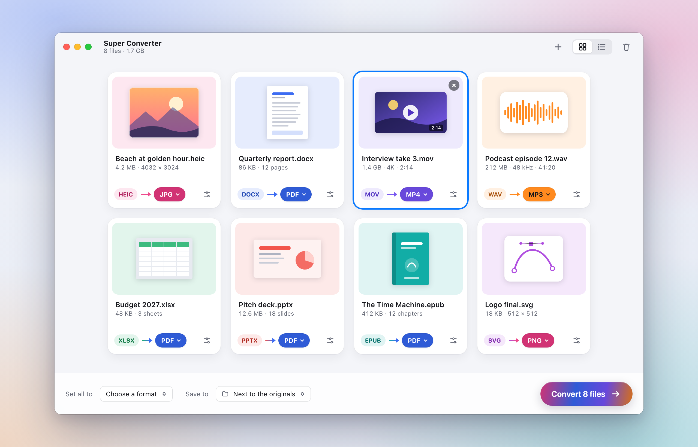

<h1 align="center">Super Converter</h1>

<p align="center">
  <b>Drop any file. Get any format. Everything on your Mac.</b><br>
  212 formats in 11 kinds — photos and camera RAW, video, audio, documents, spreadsheets, slides, e-books, archives,
  vector art, CAD drawings and fonts — converted locally, with no account and no upload.
</p>

<p align="center">
  <a href="LICENSE"></a>
  
  
  
</p>

<p align="center">
  <a href="docs/specs/formats.md"><b>Formats, engines and licences</b></a> ·
  <a href="docs/specs/quality.md">Quality</a> ·
  <a href="docs/specs/ux.md">UX design</a> ·
  <a href="docs/ARCHITECTURE.md">Architecture and work packages</a> ·
  <a href="docs/mockups/">Mockups</a>
</p>

---

Super Converter is a free, open-source macOS app that does what CloudConvert does, on your own Mac. Drop files on
the window, the Dock icon or the menu-bar icon — or right-click them in Finder — and each becomes a colourful card
that already knows what it will most likely become (HEIC → JPG, MOV → MP4, DOCX → PDF, PDF → Word). Pick another
format from a short, searchable list if you like, press **Convert**, and the new files appear next to the originals.

<p align="center"></p>

- **Every CloudConvert conversion that makes sense** — 2,140 of the 2,156 pairs in its public format list (of the
  other 16, GIF → MP3 and its kind cannot produce anything real, and AMR encoding is held back over patents), plus 112
  more — each mapped in
  [`formats.md`](docs/specs/formats.md) to the engine that does it here.
- **Built on the Mac's own engines first**: ImageIO, Core Image RAW and ColorSync for pictures, AVFoundation and
  VideoToolbox for audio and video, PDFKit, Core Text and WebKit for documents. FFmpeg (LGPL build), libarchive,
  libwebp and friends fill the gaps; a few formats use free helpers you install with one click (LibreOffice,
  calibre, Pandoc, Tectonic, Ghostscript). GPL code is never bundled.
- **Results that are right**: colour profiles kept or converted exactly, gamma-correct Lanczos resizing, transparent
  audio and video defaults, and text documents typeset like LaTeX — Latin Modern, Knuth–Plass line breaking, TeX
  math — with every promise measured by an automated quality bench ([`quality.md`](docs/specs/quality.md)).
- **Nothing leaves the Mac.** No account, no analytics; the only network use is the update check and the helper
  downloads you start.

## Install

Download `SuperConverter.dmg` from the [latest release](https://github.com/udsy19/super-converter/releases/latest), drag
Super Converter into Applications and open it (the DMG's notes say how to get past Gatekeeper: the app is self-signed,
not notarized). It updates itself from GitHub Releases; Settings › General turns that off. macOS 14 or later, Apple
silicon or Intel.

What leaves the Mac, exactly: [PRIVACY.md](PRIVACY.md). Changes: [CHANGELOG.md](CHANGELOG.md).

## Building

SwiftPM and the Command Line Tools only (no Xcode). macOS 14 or later.

```sh
scripts/fetch-vendor.sh              # the pinned vendor libraries (libwebp, libavif, libarchive, LibRaw, …) into Vendor/
scripts/tools.sh fetch               # the bundled LGPL FFmpeg, ffprobe and 7-Zip into Vendor/Tools
swift build                          # everything; `swift run sconv <files…> --to jpg` converts from the command line
swift run SuperConverterSelfTest     # headless checks for every module
swift run SuperConverterQualityBench # the quality bench (quality.md §9); report in .build/quality/index.html
scripts/signing-setup.sh             # once: a project-local signing identity in .signing/ (keep it)
scripts/build-app.sh                 # build/Super Converter.app, signed, with its static launch checks
scripts/make-dmg.sh                  # dist/SuperConverter-<version>.dmg (universal)
```

`scripts/release.sh <version>` publishes a release (the maintainer's; it needs the signing identity in `.signing/`).
Generated data: `python3 -I scripts/gen-format-matrix.py` rewrites the format matrix from the CloudConvert snapshot,
`SUPERCONVERTER_WRITE_PLISTS=1 swift run SuperConverterSelfTest` rewrites `Resources/Info.plist` and the Quick Actions'
plists from the catalog, and `sh docs/mockups/render.sh` re-renders the mockups (needs Google Chrome).

## Licence

MIT — see [LICENSE](LICENSE). Third-party components and their licences are listed in
[`THIRD_PARTY_NOTICES.md`](THIRD_PARTY_NOTICES.md) and shown in Settings › About.
