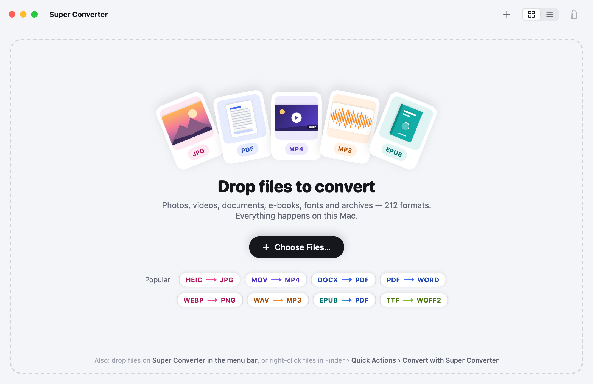
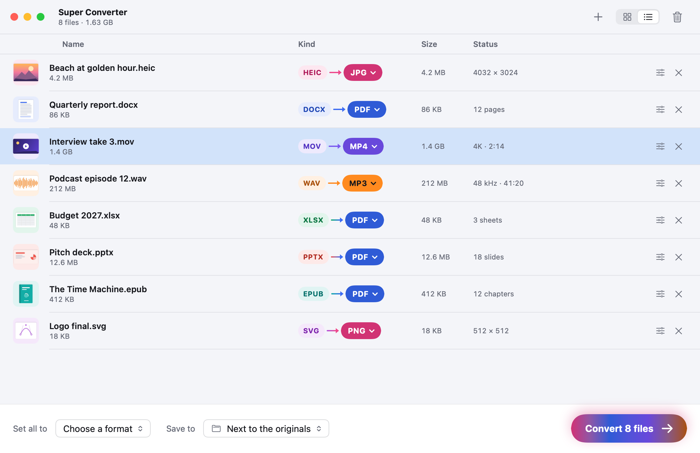
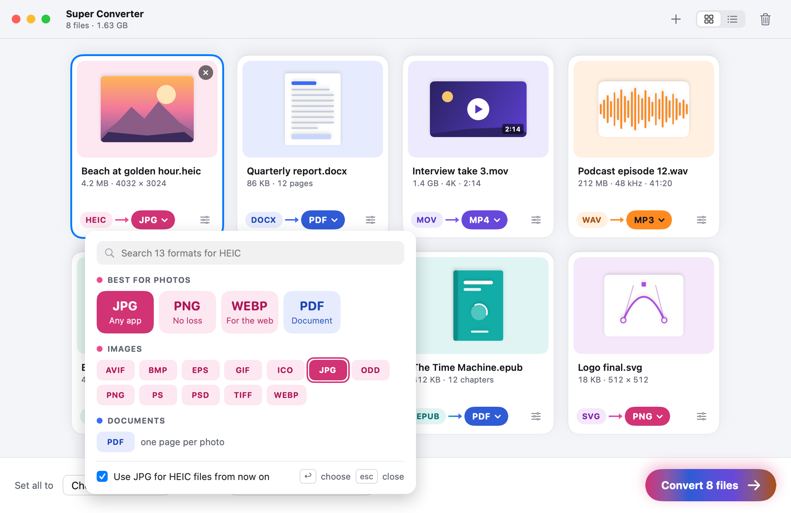
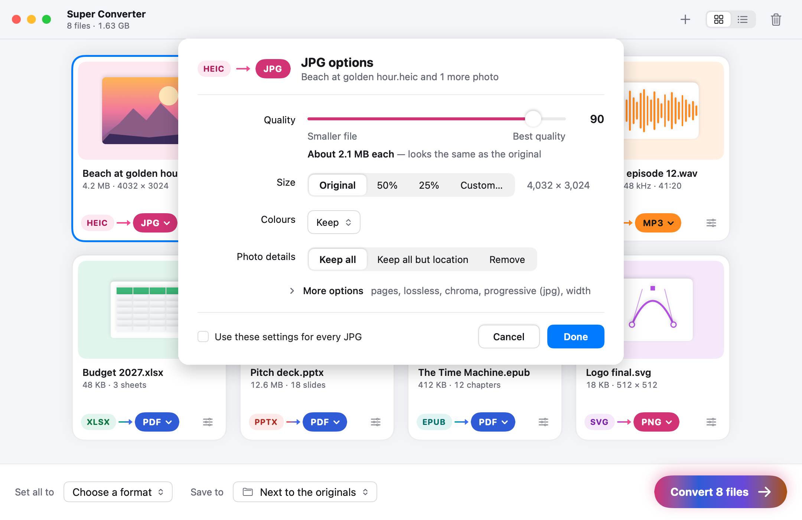
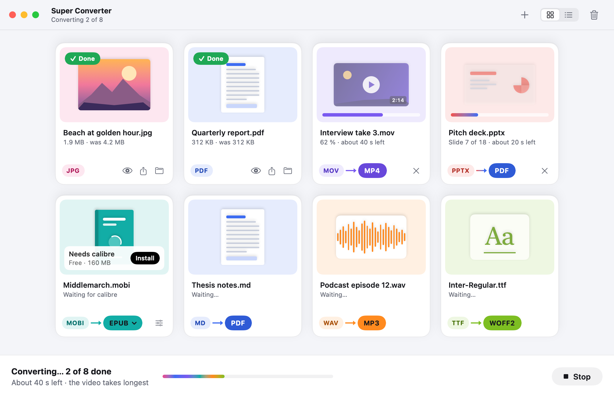
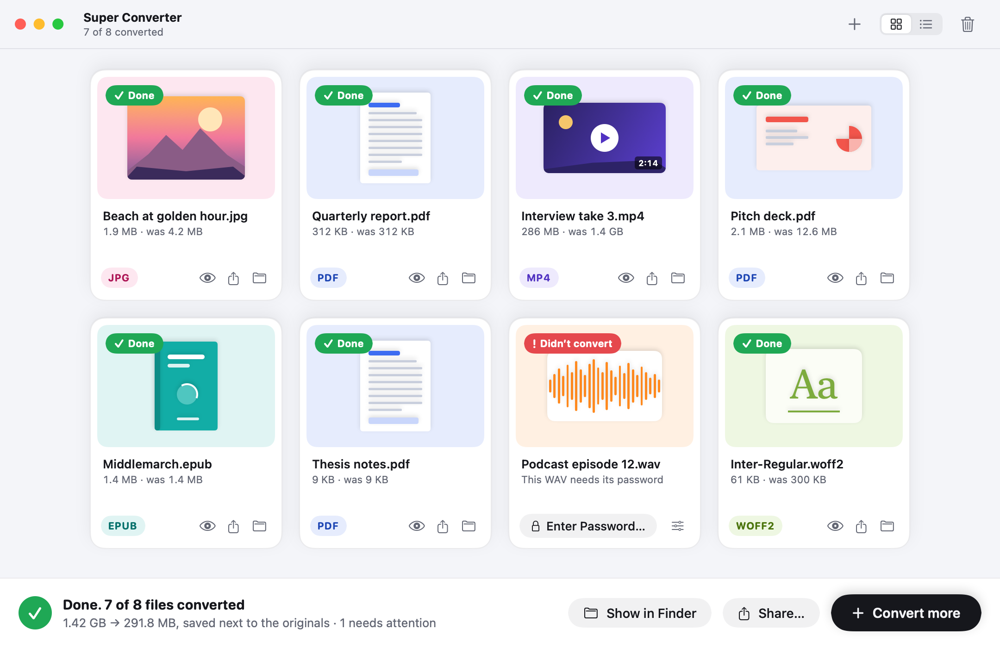
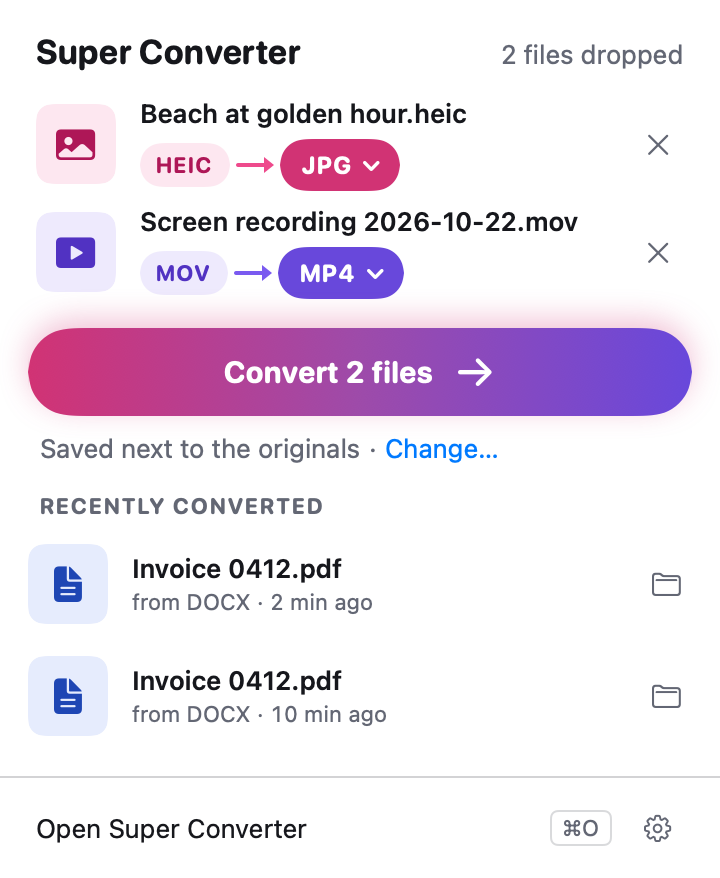
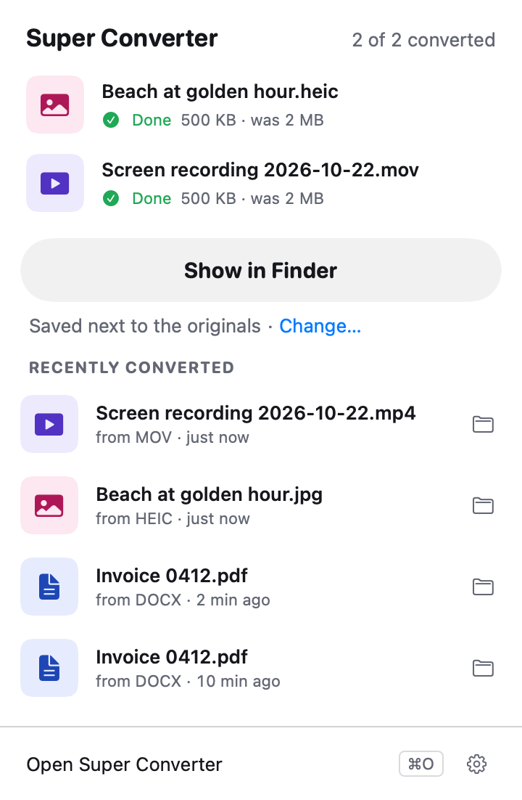
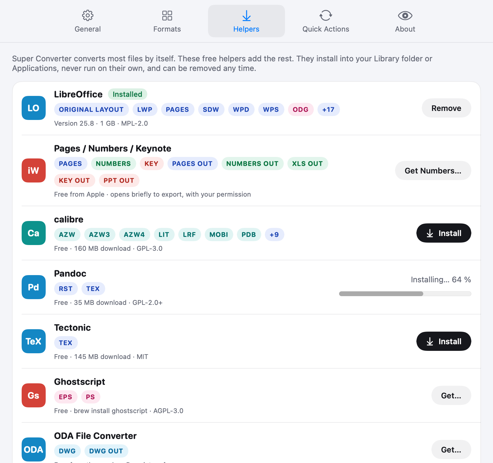
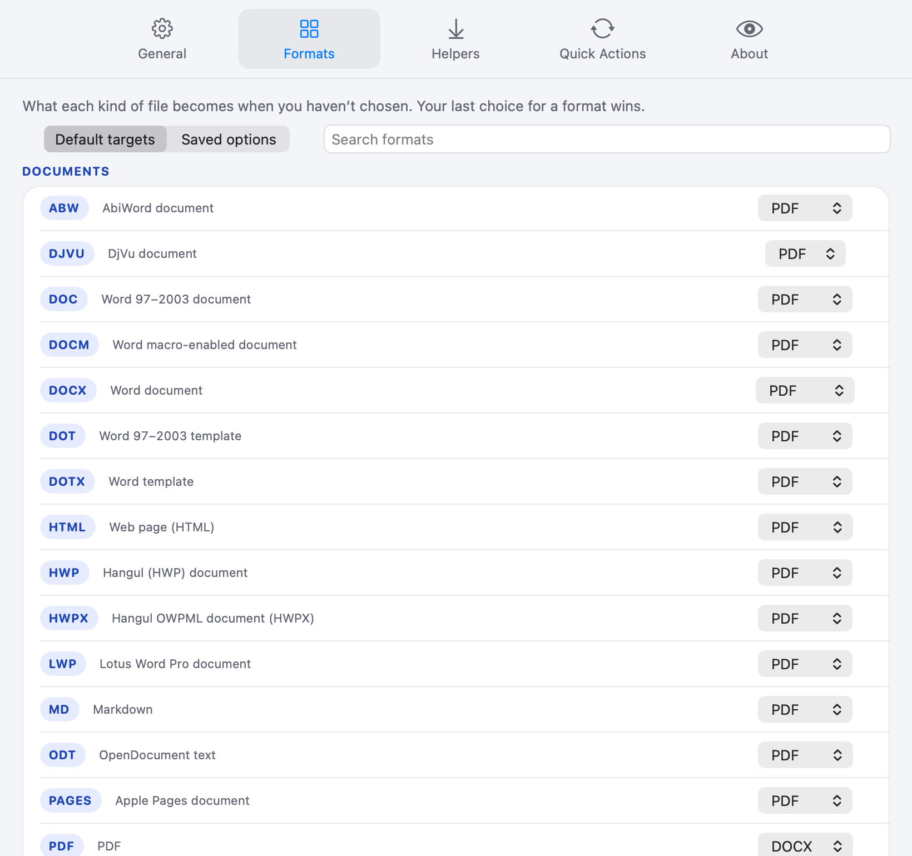

# Super Converter user guide

Everything Super Converter does, in the order you'll meet it. Short on time? The [README](../README.md#usage) has the
three-step version and the shortcut table. The specification behind every screen is [specs/ux.md](specs/ux.md).

- [Adding files](#adding-files)
- [The window](#the-window)
- [Cards](#cards)
- [Choosing a format](#choosing-a-format)
- [Options](#options)
- [Converting](#converting)
- [Results](#results)
- [Where results go](#where-results-go)
- [When something goes wrong](#when-something-goes-wrong)
- [The menu bar](#the-menu-bar)
- [Finder Quick Actions](#finder-quick-actions)
- [Services, the Dock and Open With](#services-the-dock-and-open-with)
- [Helpers](#helpers)
- [Settings](#settings)
- [Keyboard shortcuts](#keyboard-shortcuts)
- [Command line](#command-line)
- [Links (`superconverter://`)](#links-superconverter)
- [Updates](#updates)
- [Troubleshooting](#troubleshooting)
- [Uninstall](#uninstall)

## Adding files

Any of these puts files in front of Super Converter:

- Drop them anywhere on the window. While they hover, the border turns into a rainbow of the eleven kinds' colours and
  the headline says what will happen ("Drop 3 files to add them", "2 photos and a video").
- **Choose Files…** in the empty window, **+** in the toolbar, or <kbd>⌘O</kbd> (File › Add Files…, which also opens
  the window if it was closed).
- A **Popular** pair in the empty window (HEIC → JPG, MOV → MP4, DOCX → PDF, PDF → Word, WEBP → PNG, WAV → MP3,
  EPUB → PDF, TTF → WOFF2): the file chooser opens for that kind of file and the target is already set.
- The Dock icon, the menu-bar icon, Finder's **Open With › Super Converter**, a Quick Action, the Services menu, or a
  `superconverter://` link (all below).

**Folders** are expanded one level, hidden files skipped. If a folder holds more than 200 files with its subfolders,
Super Converter asks whether to include them. Files dropped on existing cards are added at the end.

**Recognising files.** Super Converter reads a file's content first and its name second, so a `.jpg` that is really a
PNG is treated as a PNG and its card says "This is a PNG file". A file nothing can read is still added and says "Super
Converter can't read this kind of file yet".

<p align="center"></p>

## The window

One window. Empty, it's a drop zone. With files, it shows a grid of cards with an action bar along the bottom:

- **Toolbar**: the title with a subtitle that follows the batch ("8 files · 1.7 GB", "Converting 2 of 8", "7 of 8
  converted"); **+** to add files; **grid / list**; and the trash to clear the window.
- **Action bar**: **Set all to** (a target every card can become, or one per kind: "Images to JPG, documents to
  PDF"), **Save to** (next to the originals, Downloads, or a folder you choose), and the **Convert 8 files** button,
  filled with the colours of the formats the batch is becoming.

**Grid and list.** <kbd>⌘1</kbd> and <kbd>⌘2</kbd> (View › as Grid / as List) switch between them. The window switches
to the list by itself when it's narrower than 640 points or holds more than 60 files. List rows can be sorted by name,
kind, size or status from the column headings.

<p align="center"></p>

Closing the window (<kbd>⌘W</kbd>) doesn't stop conversions; the menu-bar icon stays, and clicking the Dock icon
brings the window back. Quitting while files are converting asks "Stop converting 3 files?".

## Cards

Each file is a card: a Quick Look thumbnail on a tint of its kind's colour, the name, the facts that matter for its
kind (pixel size, pages, duration, sample rate, chapters, glyphs, files inside), and a row along the bottom:

- the **source pill** (HEIC), a short arrow running from the source's colour to the target's, and the **target pill**
  (JPG ▾): click it to choose another format;
- the **options** button (sliders), filled when the card's options differ from the defaults.

Click a card to select it; <kbd>⌘</kbd>-click or <kbd>⇧</kbd>-click for several, <kbd>⌘A</kbd> for all, arrow keys to
move. Picking a target or options with several cards selected changes all of them. Hover a card for its **×**, or press
<kbd>⌫</kbd>, to remove it from the window (the file itself is untouched). <kbd>Space</kbd> opens Quick Look on the
selected cards.

Each kind has its own colour: documents blue, images pink, video violet, audio orange, spreadsheets green, slides
coral, e-books teal, archives yellow, vector purple, CAD sky blue, fonts lime. Colour never works alone: every pill
carries its format's name.

**Default targets.** Before you choose, each card gets the most likely target: HEIC, HEIF, camera RAW → JPG; JPG →
PDF; PNG, TIFF, PSD and the like → PNG; animated GIF → MP4; EPS, PS, XPS and drawings → PDF (AI → SVG); SVG, EMF, WMF
→ PNG; Word, Pages, OpenDocument, Markdown, text, HTML, e-mail → PDF; PDF → DOCX; spreadsheets → XLSX (XLSX → PDF);
slides → PPTX (PPTX → PDF); EPUB and comics → PDF; Kindle and other e-books → EPUB; video → MP4; MP4 → MP3; audio → MP3
(MP3 → WAV); archives → ZIP (ZIP → 7Z); DWG, DXF, DWF → PDF; TTF, OTF → WOFF2 (web fonts → TTF). The full table is ux
§6.1. Once you pick a target for a kind of file, that choice wins from then on (unless you turn off Remember my format
choices).

## Choosing a format

Click a card's target pill, or press <kbd>T</kbd> with cards selected.

<p align="center"></p>

- **Search** first ("Search 13 formats for HEIC"). It matches extensions, names and synonyms, so "word" finds DOCX,
  "kindle" finds AZW3 and MOBI, "transparent" finds PNG and WebP, "mp3 audio" finds MP3. A leading dot is ignored.
- **Best for …**: four or five big chips with a two-word reason ("JPG · Any app", "PNG · No loss", "WEBP · For the
  web", "PDF · Document").
- **Every other target**, grouped by kind with a coloured dot, and a hint when the result isn't obvious ("PDF — one page
  per photo", "SVG — traced into shapes").
- Only targets that exist for this file appear. A target that needs a helper shows a small ⬇ and says which on hover
  ("Needs calibre — free, 160 MB").
- **Use JPG for HEIC files from now on** (on by default) makes the choice the default for that kind of file.

Type to filter, arrow keys to move, <kbd>↩</kbd> to choose, <kbd>Esc</kbd> to close.

## Options

The options button on a card, or <kbd>⌥⌘O</kbd> for the selection, opens a sheet titled with the conversion ("JPG
options", "Beach at golden hour.heic and 1 more photo").

<p align="center"></p>

The first few controls are in plain words; the rest are under **More options**, with their technical names, so experts
find them. Quality controls show a live estimate ("About 2.1 MB each — looks the same as the original"), made by
encoding a small sample in the background. **Use these settings for every JPG** saves them for that target (Settings ›
Formats lists and resets what you saved). **Done** keeps them for these cards.

What comes first, by kind:

| Converting | First options |
|---|---|
| Images | Quality, Size, Colours, Photo details (keep all, all but location, remove) |
| Camera RAW | Look, White balance, Exposure, Size |
| Video | Quality, Size, Frame rate, Sound |
| Audio | Quality, Channels, Sample rate, Loudness |
| Documents → PDF | Look (Original / As written / LaTeX), Paper, Text size, Contents page |
| Spreadsheets → PDF | Look, Sheets, Fit |
| Slides | Slides or handouts, Speaker notes |
| E-books → PDF | Page size, Text size |
| Archives | Compression, Password |
| Fonts | Subset |
| CAD | Layouts, Paper, Colours |
| Raster → SVG (tracing) | Preset, Colours, Smoothness |

**Looks for documents.** *Original* renders the document's own layout through LibreOffice (or Word or Pages when
installed); *As written* is Super Converter's own typesetter with the document's fonts and sizes (Carlito and Caladea
stand in for Calibri and Cambria); *LaTeX* typesets it like LaTeX, in Latin Modern with LaTeX's metrics, Knuth–Plass
line breaking and TeX math. Office files start on Original when a helper can render them, else As written; Markdown,
text, e-mail and e-books start on LaTeX.

**Web resources for HTML.** An HTML file is read with Super Converter's own parser and nothing it links to is
fetched. Turn on **Load web resources** in that file's options to let the page's own pictures, fonts and styles load;
it's off unless you turn it on, for that file only.

Every option for every pair, with the CloudConvert name it matches: [specs/formats.md](specs/formats.md) §5. The same
list for one pair from the command line: `sconv --from heic --to jpg --list-options`.

## Converting

Press **Convert** (<kbd>⌘↩</kbd>, Convert › Convert).

<p align="center"></p>

- Cards convert in the order shown, several at once: video one at a time (two on Macs with two media engines), audio
  four, images and documents up to the number of performance cores, archives two, one job per helper. Small files
  start alongside a long video.
- A converting card fills a progress capsule in the colours of its conversion and says how far it is ("62 % · about
  40 s left", "Slide 7 of 18", "Page 3 of 12"). Waiting cards say "Waiting…". Cards stay editable until they start.
- The action bar shows "Converting… 2 of 8 done", the time left and an overall bar. The Dock icon shows progress and a
  badge with the files left.
- **Stop** (<kbd>⌘.</kbd>) stops everything. Nothing half-written is left behind: partial files are deleted.
- Your Mac doesn't sleep while it converts. You can hide the app or close the window.

## Results

<p align="center"></p>

Each finished card turns to its new format's colour, shows the new file's thumbnail, name and size ("1.9 MB · was
4.2 MB"), and three buttons: **Quick Look**, **Share** and **Show in Finder**.

- <kbd>Space</kbd> toggles Quick Look on any selected card. A finished card previews its result (every file inside a
  "name (FORMAT)" folder for multi-file results); a waiting card previews its original. With several selected, the
  arrow keys page through them.
- Double-click a finished card to open the result in its default app, or drag it out to Finder, Mail or anywhere
  else.
- **Loss notes**: what a conversion couldn't carry over is an ⓘ line under the facts ("ⓘ Layers flattened"); click it
  for the full list.
- The action bar says "Done. 7 of 8 files converted" with the sizes before and after and where they were saved, and
  offers **Show in Finder** (all the results, <kbd>⇧⌘R</kbd>), **Share…** and **Convert more** (clears the finished
  cards).
- If the window was in the background for a batch longer than 10 seconds, a notification says the same, with a Show
  action.

## Where results go

- **Next to the originals** by default, with the same name and the new extension: `Beach.heic` → `Beach.jpg`. Settings ›
  General or the action bar's **Save to** can send them to Downloads or a folder instead.
- If that folder can't be written to, the result goes to Downloads and the card says so.
- **Names that are taken** get " 2", " 3", as Finder does. Settings › General can make it **Replace** or **Ask**
  instead; even Replace never replaces the file you're converting.
- **Several files from one** (pages, slides, frames, archive contents, SoundFont samples) go into a folder named
  "Report (PNG)" with names like "Report – page 1.png".
- Creation and modification dates are copied from the original. Results are written in a hidden work folder and moved
  into place only when complete.
- **Originals are never moved, renamed or deleted.**

## When something goes wrong

A card that can't convert says why in one line and offers the one fix:

| The card says | Button |
|---|---|
| "This PDF needs its password" | Enter Password… |
| "This file looks damaged — it couldn't be read as DOCX" | Try with LibreOffice (when it's installed) |
| "Needs calibre" | Install / Get… |
| "LibreOffice took longer than 2 minutes and was stopped" | Try Again |
| "There isn't enough space on “Macintosh HD” — 1.2 GB more is needed" | Show in Finder |
| "Super Converter can't save into “Shared”" | Choose Another Folder… |
| "Super Converter can't read this kind of file yet" | Show in Finder |
| "This book is locked by the store it came from (DRM) and can't be converted" | — |

**Archives that expand like a bomb** (more than 1,000 times their size and past 10 GB) ask before they're unpacked.
Hard limits stop runaway archives either way (64 GB written, a million entries, three archives deep).

Some pairs are deliberately not offered, and searching for them says why: GIF and WebP pictures have no sound, DSS
can only be decoded, and AMR files aren't written (AMR still converts to other formats).

## The menu bar

Super Converter puts a small icon in the menu bar (turn it off in Settings › General › Show in menu bar).

<p align="center"> </p>

- **Drop files on the icon** and a panel opens listing them with their default targets (change them with the same
  pills and picker), **Convert 2 files**, and "Saved next to the originals · Change…".
- **Click the icon** for the same panel, with a small drop area when it's empty.
- **Recently converted** lists the last 10 results, each with Show in Finder.
- The footer has **Open Super Converter** (<kbd>⌘O</kbd>) and Settings.

Conversions from the panel run in the background and notify when they're done.

## Finder Quick Actions

Right-click files in Finder › **Quick Actions** (also in the Finder preview pane and the Touch Bar):

| Action | Shows for | What it does |
|---|---|---|
| Convert with Super Converter… | Any file | Opens the files in the window |
| Convert to JPG | Images | Converts in the background with your saved JPG settings |
| Convert to PNG | Images | The same, to PNG |
| Convert to PDF | Documents, images, slides, sheets and e-books | The same, to PDF |
| Convert to MP4 | Videos | The same, to MP4 |
| Convert to MP3 | Audio and videos | The same, to MP3 |

Each one appears only for files it can take. One-step actions convert in the background, put the results next to the
originals and post a notification. Convert to JPG, PNG and PDF are switched on the first time Super Converter opens;
MP4 and MP3 wait until you switch them on in Settings › Quick Actions (or in System Settings' Extensions).
macOS lists them once Super Converter is in your Applications folder and has been opened.

## Services, the Dock and Open With

- **Services**: the same six actions are in the Services menu (right-click › Services in Finder, or the app menu ›
  Services in any app with files selected).
- **The Dock icon** takes dropped files like the window.
- **Open With**: Finder's Open With › Super Converter lists it for all 212 formats it reads, without making it any
  file's default app.

## Helpers

Super Converter converts most files by itself. A few formats need a free tool; a card that needs one shows a notice in
its thumbnail, **"Needs calibre — Free · 160 MB"** with **Install** (or **Get…** for tools installed another way).
Install shows its progress in the same notice ("Installing calibre… 64 %"), verifies the download, and the card
converts as soon as it's ready while the other cards keep going. When a helper would only do better ("Original layout
needs LibreOffice"), the card converts without it and the finished card offers "Make it look like the original —
Install LibreOffice".

<p align="center"></p>

| Helper | Adds | Install |
|---|---|---|
| **LibreOffice** (MPL-2.0) | LWP, SDW, WPD, WPS, ET, SDC, DPS, SDA, PPT/PPS/POT, ODP, ODG, PUB, CDR, VSD and CGM input; DOC, XLS, PPT and ODP output; the original office layout | One click, 360 MB, into `~/Applications` |
| **calibre** (GPL-3.0) | AZW, AZW3, AZW4, LIT, LRF, MOBI, PDB, PML, PRC, RB, SNB and TCR input; AZW3, MOBI, LRF and PDB output | One click, 160 MB, into `~/Applications` |
| **Pandoc** (GPL-2.0+) | RST input; TeX to anything but PDF | One click, 35 MB, into Application Support |
| **Tectonic** (MIT) | TeX to PDF with a real LaTeX run | One click, 145 MB, into Application Support |
| **Pages, Numbers, Keynote** (free from Apple) | PAGES, NUMBERS and KEY input and output; the best PPT, PPTX and XLS to PDF | Get… opens the App Store |
| **Microsoft Office** | The best DOC, DOCX, XLS, XLSX, PPT and PPTX to PDF | Used when installed |
| **Ghostscript** (AGPL-3.0) | EPS and PS input; PostScript-based AI | `brew install ghostscript` |
| **DjVuLibre** (GPL-2.0+) | DJVU input | `brew install djvulibre` |
| **ODA File Converter** (freeware) | DWG input and output, every AutoCAD version | Get… opens the vendor's page |
| **LibreDWG** (GPL-3.0) | DWG input and output when ODA is absent | `brew install libredwg` |
| **FFmpeg GPL encoders** (GPL-2.0+) | CAVS output; optional x264 and x265 encoders | `brew install ffmpeg` |
| **RAR** (shareware) | RAR output | Get… opens RARLAB's page |
| **sfArk tool** (GPL-3.0) | SFARK input | Built from source (Get… explains) |

How installs work:

- **One click** downloads upstream's own release, pinned to a version and its SHA-256. Apps must also carry their
  publisher's Developer ID signature and Apple's notarisation. Apps are copied to `~/Applications`; command-line tools
  are unpacked under `~/Library/Application Support/Super Converter/Helpers/`.
- **Homebrew and the usual places**: GPL and AGPL tools without an official macOS build are never redistributed by this
  project. Super Converter looks for them where Homebrew installs them (`/opt/homebrew/bin`, `/usr/local/bin`) and in
  their usual install paths. **Choose location…** in Settings › Helpers points it anywhere else.
- **Remove** takes an installed helper away again.
- Helpers **never run on their own**, only for a conversion you started, with a time limit per file (LibreOffice 2
  minutes, calibre and Tectonic 5 minutes) and without network access.
- When a conversion drives Pages, Numbers, Keynote or Office, the app opens briefly to export, and macOS asks once
  for permission (Automation).
- Tectonic fetches the TeX packages its warm-up needs once, right after you install it; every later run is offline.

## Settings

<kbd>⌘,</kbd> (Super Converter › Settings…). Five panes:

<p align="center"></p>

- **General**: **Save to** (next to the originals · Downloads · a folder); **When a file with that name exists** (add a
  number · replace · ask); **Keep originals** (always: converting never changes or removes them); **Remember my format
  choices**; **Show in menu bar**; **Notify when done**; **Play a sound when done** (off). Appearance follows the
  system.
- **Formats**: *Default targets* lists what each kind of file becomes when you haven't chosen, editable and resettable
  per format; *Saved options* lists the settings saved with "Use these settings for every …", each openable and
  resettable. Both are searchable.
- **Helpers**: every helper with what it unlocks, its status (installed with version and size, not installed with the
  download size, or installing with progress), its licence and **Install**, **Remove** or **Get…**; **Choose
  location…** for one that lives somewhere unusual.
- **Quick Actions**: the six actions with what each takes and a switch for each. Switching one here switches it in
  System Settings too, and **Open Extensions Settings…** goes there.
- **About**: the version, **Updates** with Check for Updates and the update status, **Check for updates
  automatically**, the privacy statement, the licences of everything inside the app, and the source code link.

## Keyboard shortcuts

| Shortcut | Action |
|---|---|
| <kbd>⌘O</kbd> | Add files (opens the window if it's closed) |
| <kbd>⌘↩</kbd> | Convert |
| <kbd>⌘.</kbd> | Stop (partial files are deleted) |
| <kbd>Space</kbd> | Quick Look the selected cards (toggle) |
| <kbd>⌫</kbd> | Remove the selected cards from the window |
| <kbd>⌘A</kbd> | Select all cards |
| <kbd>T</kbd> | Open the format picker for the selection |
| <kbd>⌥⌘O</kbd> | Options for the selection |
| <kbd>←</kbd> <kbd>→</kbd> <kbd>↑</kbd> <kbd>↓</kbd> | Move between cards |
| <kbd>⌘1</kbd> · <kbd>⌘2</kbd> | Grid · list |
| <kbd>⇧⌘R</kbd> | Show results in Finder |
| <kbd>⌘,</kbd> | Settings |
| <kbd>⌘W</kbd> | Close the window (conversions continue) |
| <kbd>⌃⌘F</kbd> | Full screen |
| In the picker: type, arrows, <kbd>↩</kbd>, <kbd>Esc</kbd> | Filter, move, choose, close |

Every control can be reached with the keyboard (Tab with Full Keyboard Access) and shows a focus ring. Each card is
one VoiceOver element ("Beach at golden hour, HEIC photo, 4.2 megabytes. Becomes JPG.") with the actions Change
format, Options, Remove and Quick Look.

## Command line

`sconv` uses the same planner, engines and output rules as the app. It's built from source and isn't in the app
bundle:

```bash
git clone https://github.com/udsy19/super-converter.git && cd super-converter
scripts/fetch-vendor.sh && scripts/tools.sh fetch
swift build -c release --product sconv
cp .build/release/sconv /usr/local/bin/      # or anywhere on your PATH
```

```
usage: sconv <files…> --to <format> [--option key=value]… [--out DIR] [--look original|written|latex]
       sconv <files…> | --from <format> --list-targets
       sconv --from <format> --to <format> --list-options
```

| Flag | Meaning |
|---|---|
| `--to`, `-t` *format* | The target, by extension (`jpg`, `.pdf`, `WOFF2`) |
| `--option`, `-O` *key=value* | One option; repeat for more. Values are numbers, `yes`/`no`, or a choice's id |
| `--out`, `-o` *folder* | Where results go (default: next to each original) |
| `--look original\|written\|latex` | For pairs that have a separate LaTeX route (HTML, LWP, SDW, WPD → PDF and pictures) |
| `--from` *format* | With `--list-targets` or `--list-options`, ask about a format without a file |
| `--list-targets` | What each file (or `--from` format) can become: built in, with a helper, or needs one |
| `--list-options` | Every option of a pair: key, values, default, label |
| `--` | Everything after it is a file, even if it starts with `-` |

Examples:

```bash
sconv photo.heic --to jpg                                # → photo.jpg next to photo.heic
sconv *.heic --to jpg --option quality=85 --out ~/Desktop/jpgs
sconv scan.tiff --to jpg --option metadata=allButLocation --option size=50
sconv report.docx --to pdf --option look=latex           # Original, As written or LaTeX (look=original|asWritten|latex)
sconv clip.mov --to mp4 --option size=1080 --option sound=none
sconv song.wav --to mp3
sconv book.epub --to pdf --out ~/Documents
sconv --from heic --list-targets
sconv --from mov --to mp4 --list-options
```

`sconv --from heic --list-targets` prints one line per target, tab-separated:

```
avif	AVIF (AV1 image)	built in
bmp	Windows bitmap	built in
…
webp	WebP	built in
```

`sconv --from heic --to jpg --list-options` prints key, values, default and label:

```
quality	1-100	90	Smaller file ↔ Best quality
chroma	420|444	444	Chroma
size	original|50|25|custom	original	Size
colourProfile	keep|srgb|displayP3|adobeRGB|proPhoto|gray|cmyk|custom	keep	Colours
metadata	all|allButLocation|none	all	Photo details
…
```

**Output.** Converted file paths go to standard output, one per line, so they pipe; loss notes, warnings and problems
go to standard error. Every file is planned before anything runs, so a wrong option stops the command before it
converts anything ("no option “nope” here; the options are: look, paper, baseSize, …").

**Exit status.** `0` all converted · `1` something didn't convert · `2` something stopped on a question (an archive
that expands like a bomb; the message names the option that answers yes, e.g. `--option extractAnyway=yes`) · `64`
wrong usage · `130` stopped with Ctrl-C (running jobs stop and their partial files are deleted).

`sconv` doesn't follow the app's "When a file with that name exists" setting: names that are taken always get " 2".

## Links (`superconverter://`)

Two link forms, for Shortcuts, Raycast, Alfred, scripts and Terminal (`open "superconverter://…"`). Paths are absolute
(URL-encode spaces as `%20`); repeat `file=` for several files.

| Link | What it does |
|---|---|
| `superconverter://open?file=/Users/me/a.heic&file=/Users/me/b.heic` | Adds the files to the window |
| `superconverter://convert?file=/Users/me/a.heic&to=jpg` | Adds the files to the window with JPG as their target; omit `to` for each file's default |

Any web page, e-mail or app can open a link, so a link from anywhere else only fills the window with existing files
(folders are skipped) and waits for you to press Convert. Only links sent by Super Converter's own Quick Action
extensions and Services entries, which you start in Finder, convert straight away in the background. Super Converter
tells them apart by checking the code signature and location of the process that sent the link.

## Updates

Super Converter updates itself from this repository's GitHub Releases: a minute after launch and then every six
hours it asks for the latest release. A newer version is downloaded, installed only if its SHA-256 matches the one
published with the release and its signature matches the copy that's running, and swapped in when you quit (or sooner
when the app is idle in the background with nothing to convert). Turn the automatic part off with Settings › About ›
**Check for updates automatically**; **Check for Updates…** in the app menu still checks when you ask.

## Troubleshooting

- **Quick Actions don't appear.** Move Super Converter to Applications and open it once. Then check Settings › Quick
  Actions (or the Finder section of System Settings' Extensions). One-step actions only show for files they
  can take.
- **"Needs …" on a card.** Install the helper from the card or Settings › Helpers. For a Homebrew tool, install it with
  `brew install …` and Super Converter finds it; for one somewhere else, use **Choose location…**.
- **A document doesn't look like the original.** Install LibreOffice and choose Look › Original in the card's options.
- **A helper keeps timing out.** Very large files can take longer than the per-file limit; split them, or try again
  with nothing else converting.
- **macOS asks to allow Super Converter to control Pages (or Word).** That's the Automation permission for exporting a
  file through that app; it's only asked when a conversion needs it. Change it in System Settings › Privacy & Security
  › Automation.
- **Logs.** Console.app, filtered by `com.udsy.superconverter`.

## Uninstall

Quit Super Converter and delete it from Applications. To remove everything it keeps, also delete:

- `~/Library/Application Support/Super Converter` (installed command-line helpers and their record, the recent list,
  the updater's bookkeeping, LibreOffice's private profile, Tectonic's package cache);
- `~/Library/Caches/Super Converter` (thumbnails);
- its preferences: `defaults delete com.udsy.superconverter`.

Helper apps you installed (LibreOffice, calibre) are in `~/Applications`; delete them there if you don't want them.
